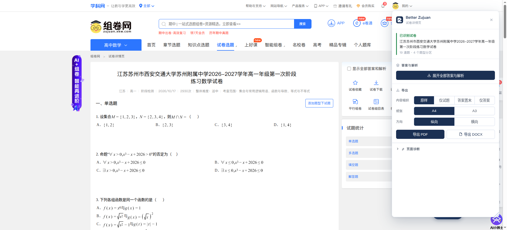
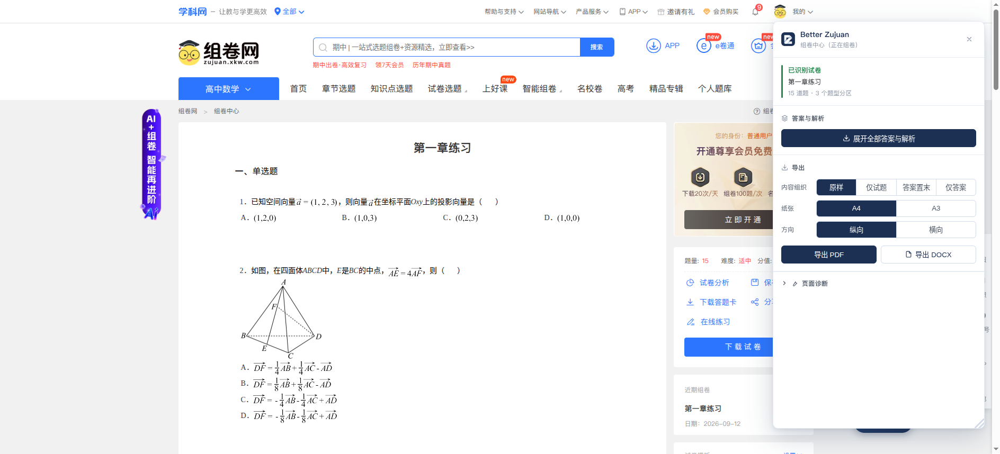
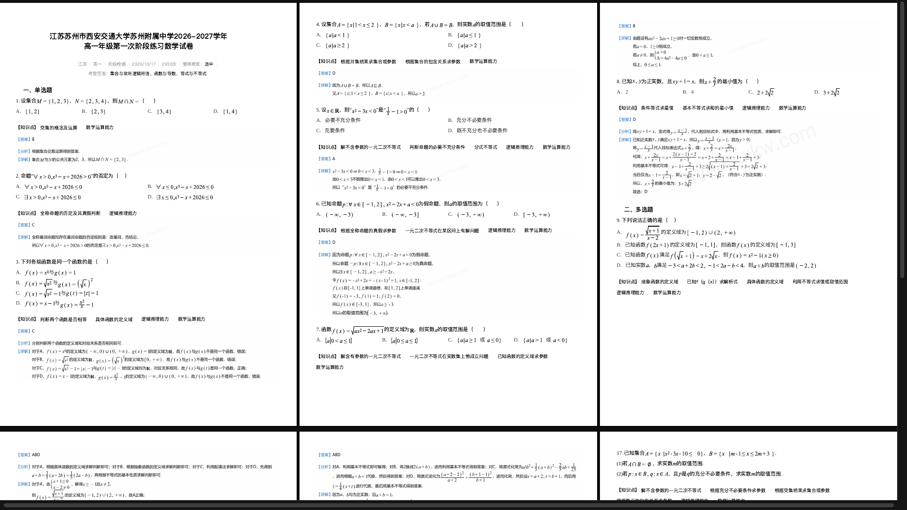

<div align="center">
  <a href="https://github.com/rong6/BetterZujuan">
    
  </a>
</div>

<p align="center">
  组卷网（zujuan.xkw.com）的试卷导出增强：一键展开全部答案解析，导出干净的 PDF 与<strong>公式可编辑</strong>的 DOCX。
</p>

---

## ✨ 功能

一套扩展同时支持三种页面，各自按本站真实结构采集：

| 页面 | URL | 说明 |
| --- | --- | --- |
| 试卷详情页 | `/{题库ID}p{试卷ID}.html` | 组卷网公开试卷 |
| 个人题库试卷 | `/usertk/{题库ID}p{试卷ID}.html` | 我的题库里的卷 |
| 组卷中心 | `/zujuan` | 正在组的那份卷 |

### 🩹 灰色蒙版修复

往试题篮里加过题之后，组卷网会给题目容器加上半透明蒙版，整卷看起来蒙了一层灰。

这层灰**会被印进 PDF、也会被 Word 继承**。扩展在导出时把它还原，屏幕上保持站点原样，不动你的页面。

### 🧹 页面净化

导出时自动剔除站点框架、面包屑、侧栏、「试卷分析」区块、每题的操作条等噪声，只留试卷正文。

**原始页面全程只读** —— 不做任何删除或改写。这一点和常见的用户脚本有本质区别：那些脚本往往清空 `body` 再刷新，容易破坏页面状态，还可能让已加载的答案图重新请求、变成一张「无权限」的提示图。

### ⚡ 答案与解析

- **并发获取整卷**，一次展开全部答案（19 题的卷实测约 5 秒）
- 校验图片有效性：链接失效时服务端会返回一张「假图」但 HTTP 仍是 200，扩展按尺寸识别并如实报错
- 校验通过立刻固化为本地数据，避免链接过期导致导出时变成报错图
- 结果始终按试卷顺序排列

### 🧩 答案与知识点

- 知识点与答案解析**作为一个整体**处理：选择「答案置末」时两者一起搬到文末，不会把知识点孤零零留在题目那边
- 知识点字号向答案图片内的正文看齐，视觉上保持同一行文字大小
- 去掉知识点里没有意义的「解读」按钮与 `javascript:` 伪链接

### 📄 PDF 导出

- 四种内容组织：**原样** / 仅试题 / 答案置末 / 仅答案
- A4、A3，纵向、横向
- 「原样」走零 DOM 变更路径，只注入打印样式
- 题目之间只用留白分隔，纸面上没有任何多余的分隔线
- 选了「答案置末」时，答案部分自动另起一页

### 📝 DOCX 导出（公式可编辑）

- 公式转为 **Word 原生公式对象**，点开就能改（实测一份 19 题的数学卷得到 132 个公式对象，含分式、根式、上标、定界符）
- 题图按**页面实际显示尺寸**排版，同时嵌入更高分辨率的像素，版面与清晰度兼得
- 选项表格自动去掉边框，与页面观感一致
- 图片有任何缺失都会**带上题号**告警，绝不静默丢失

### 🪟 界面

右下角悬浮入口，点开是可拖动、可缩放的浮动面板（不是钉死的侧边栏）。拖标题栏移动，拖右下角调整大小，`Esc` 关闭。

---

## 📦 安装

### 方式一：下载已编译版本

到 [Releases](https://github.com/rong6/BetterZujuan/releases) 下载最新的预发布包：

- `better-zujuan-*-chrome.zip` —— Chrome / Edge
- `better-zujuan-*-firefox.zip` —— Firefox

解压后按下面的「加载到浏览器」步骤加载即可。

### 方式二：从源码构建

需要 Node.js 22+ 与 pnpm。

```bash
pnpm install
pnpm build          # Chrome / Edge (MV3) → .output/chrome-mv3
pnpm build:firefox  # Firefox (MV2)      → .output/firefox-mv2
```

### 加载到浏览器

**Chrome / Edge**

1. 打开 `chrome://extensions/`
2. 右上角开启「开发者模式」
3. 点「加载已解压的扩展程序」，选择 `chrome-mv3` 目录

**Firefox**

1. 打开 `about:debugging#/runtime/this-firefox`
2. 点「临时载入附加组件」，选择 `firefox-mv2/manifest.json`

> Chrome 137 起已移除 `--load-extension` 命令行参数。若需自动化加载，请使用 CDP 的 `Extensions.loadUnpacked`。

---

## 🚀 使用

1. 打开一份试卷（上面三种页面之一），点右下角的 **「试卷导出」**。
2. 确认面板顶部的识别结果：试卷名、题目数、题型分区数。
3. 需要答案就先点 **「展开全部答案与解析」**（整卷并发加载，一次完成）。
4. 选择内容组织方式与纸张设置，然后：
   - **导出 PDF** —— 在浏览器打印窗口里选「另存为 PDF」；
   - **导出 DOCX** —— 直接下载可编辑文档。

> 💡 从源码改动过代码的话，记得去 `chrome://extensions/` 点一次「重新加载」**并刷新页面**。内容脚本只在页面加载时注入，已打开的标签页不会自动更新到新版本。

---

## 🖼️ 截图

**试卷详情页 —— 展开答案、配置导出**



**组卷中心 —— 正在组的那份卷同样可以导出**



**导出效果 —— 净化后的打印版式（题目之间无多余线条，知识点与题目同排）**



---

## ⚠️ 已知限制

- **答案加载依赖登录状态**，未登录时面板会明确提示，不会静默失败。
- **组卷中心的答案常取不到**：未登录或当日额度用尽时，答案容器是空的，此时只能导出题目。
- **暂不支持 `/basic/`** 等其它组卷入口，需要各自新增页面适配。
- **PDF 与 DOCX 无法逐像素一致**：两者是两套渲染引擎（CSS 打印 vs OOXML），共用的是内容与版面决策，字体与行距细节可能有差异。
- **Firefox 构建有两条 WXT 警告**（缺少 `data_collection_permissions` 与扩展 ID），尚未处理。

---

## 🔒 隐私与安全

- **无遥测、无远程日志、不上传任何试卷内容。**
- **不申请任何浏览器 API 权限**，只声明四个站点的 host 权限：
  `zujuan.xkw.com`（页面）、`staticzujuan.xkw.com`（公式）、`imzujuan.xkw.com`（答案图）、`img.xkw.com`（题图）。
- 答案图片以内存 blob 形式保存在当前标签页，随加载器销毁而释放。
- 所有网络请求都指向站点自身的域名，不引入任何第三方服务。
- 仓库里的测试夹具与导出样例均已脱敏，不含真实令牌或账号标识。

---

## 🛠️ 开发

```bash
pnpm install
pnpm dev              # 开发模式（Chrome，自带热更新）
pnpm dev:firefox      # 开发模式（Firefox）
pnpm run check        # 注释自检 + 类型 + 测试 + 构建 + 产物自检
pnpm test             # 单元测试
```

架构说明、站点结构实测记录、以及每一条设计取舍的原因，都写在 **[docs/TECHNICAL.md](docs/TECHNICAL.md)**。

---

## 📚 文档

| 文档 | 内容 |
| --- | --- |
| [docs/TECHNICAL.md](docs/TECHNICAL.md) | 架构、站点结构实测、实现取舍、质量保障 |

---

## 📜 许可证

**GNU General Public License v3.0 or later**（GPL-3.0-or-later），全文见 [LICENSE](LICENSE)。

本项目与学科网 / 组卷网无任何隶属关系，为个人开发的第三方工具。
